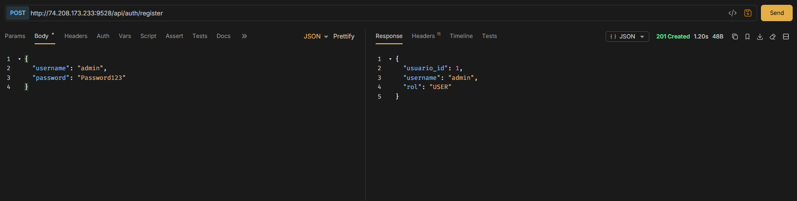
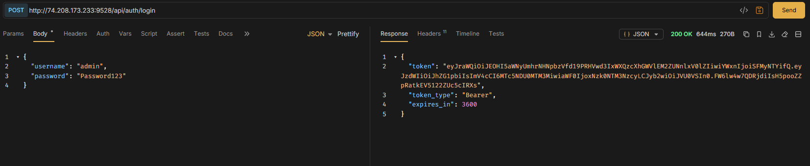
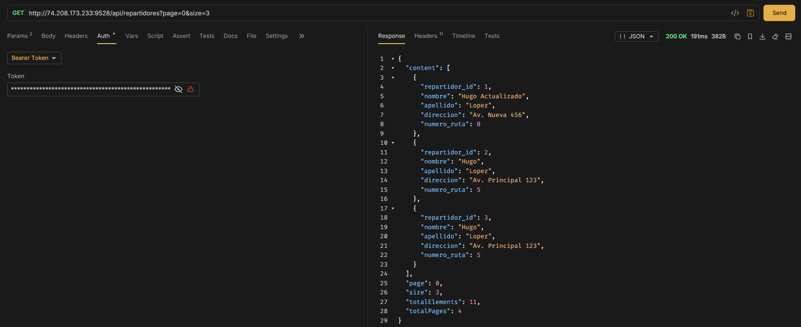
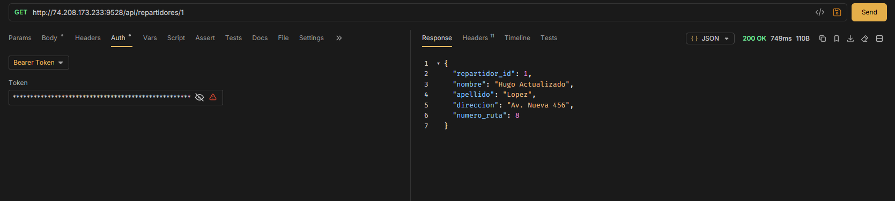
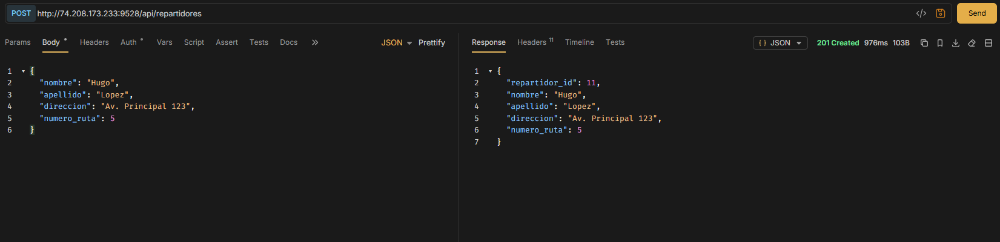
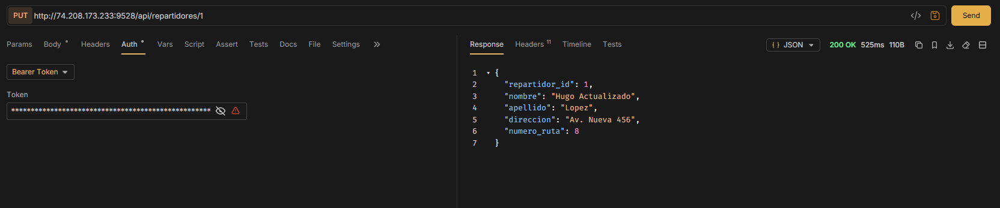
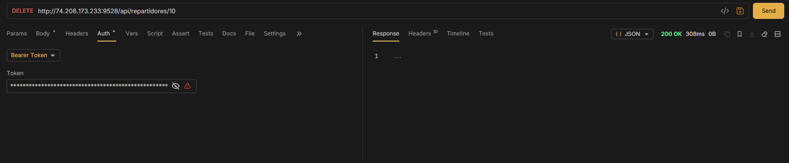
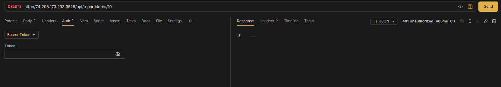

# JNVact4_t4 - API REST de repartidores

API REST desarrollada con Spring Boot, MySQL, Spring Data JPA, DTOs, Bean Validation, Spring Security y JWT. La aplicación no utiliza vistas Thymeleaf: todas las operaciones se realizan mediante endpoints JSON.

## Tecnologías

- Java 25
- Spring Boot 4.1.2
- Spring Web MVC
- Spring Data JPA
- MySQL
- Spring Security
- JWT con OAuth2 Resource Server
- Maven
- Bruno para pruebas de la API

## Funcionalidades

- Registro y autenticación de usuarios.
- Contraseñas almacenadas con BCrypt.
- Tokens JWT firmados y con expiración.
- CRUD protegido de repartidores.
- Paginación en el listado.
- DTOs separados para entrada y salida.
- Validación de datos con Bean Validation.
- Respuestas HTTP apropiadas: `200`, `201`, `400`, `401`, `404` y `409`.

## Configuración local

1. Copia `.env.example` como `.env`.
2. Sustituye los valores de ejemplo por los de tu entorno.
3. Asegúrate de que MySQL esté ejecutándose y que exista la base de datos:

```sql
CREATE DATABASE jnvact4_t4;
```

`.env` está excluido de Git y no debe subirse al repositorio.

## Ejecutar localmente

En Windows:

```powershell
.\mvnw.cmd spring-boot:run
```

En Linux:

```bash
./mvnw spring-boot:run
```

La API queda disponible en:

```text
http://localhost:9528
```

## Autenticación

### Registrar usuario

```http
POST /api/auth/register
Content-Type: application/json
```

```json
{
  "username": "admin",
  "password": "Password123"
}
```

Respuesta: `201 Created`.

La respuesta no incluye el campo `password`.

### Iniciar sesión

```http
POST /api/auth/login
Content-Type: application/json
```

```json
{
  "username": "admin",
  "password": "Password123"
}
```

Respuesta:

```json
{
  "token": "JWT_GENERADO",
  "token_type": "Bearer",
  "expires_in": 3600
}
```

Para acceder al CRUD, usa el token recibido:

```http
Authorization: Bearer JWT_GENERADO
```

Sin token o con un token inválido, el servidor responde `401 Unauthorized`.

## Endpoints del CRUD

Todos los endpoints de repartidores requieren un JWT válido.

### Listar repartidores

```http
GET /api/repartidores?page=0&size=10
Authorization: Bearer JWT_GENERADO
```

Respuesta:

```json
{
  "content": [],
  "page": 0,
  "size": 10,
  "totalElements": 0,
  "totalPages": 0
}
```

### Consultar un repartidor

```http
GET /api/repartidores/{repartidor_id}
Authorization: Bearer JWT_GENERADO
```

Devuelve `200 OK` si existe o `404 Not Found` si no existe.

### Crear un repartidor

```http
POST /api/repartidores
Authorization: Bearer JWT_GENERADO
Content-Type: application/json
```

```json
{
  "nombre": "Hugo",
  "apellido": "Lopez",
  "direccion": "Av. Principal 123",
  "numero_ruta": 5
}
```

Devuelve `201 Created`.

### Actualizar un repartidor

```http
PUT /api/repartidores/{repartidor_id}
Authorization: Bearer JWT_GENERADO
Content-Type: application/json
```

```json
{
  "nombre": "Hugo Actualizado",
  "apellido": "Lopez",
  "direccion": "Av. Nueva 456",
  "numero_ruta": 8
}
```

Devuelve `200 OK` o `404 Not Found`.

### Eliminar un repartidor

```http
DELETE /api/repartidores/{repartidor_id}
Authorization: Bearer JWT_GENERADO
```

Devuelve `200 OK` o `404 Not Found`.

## Validación de datos

Los siguientes campos son obligatorios:

- `nombre`: máximo 100 caracteres.
- `apellido`: máximo 100 caracteres.
- `direccion`: máximo 255 caracteres.
- `numero_ruta`: entero mayor que cero.
- `username`: máximo 100 caracteres.
- `password`: entre 8 y 72 caracteres durante el registro.

Los errores de validación devuelven `400 Bad Request` con los campos que fallaron:

```json
{
  "status": 400,
  "error": "Validation failed",
  "message": "Uno o más campos tienen datos inválidos",
  "fields": {
    "nombre": "El nombre es obligatorio"
  }
}
```

## Colección de Bruno

La colección está dentro de:

```text
/bruno
```

Debe incluir estas peticiones:

1. Registro.
2. Login.
3. Listado paginado.
4. Consulta individual.
5. Creación.
6. Actualización.
7. Eliminación.
8. Consulta protegida sin token.

En Bruno selecciona el entorno `Local` y copia el token de la respuesta de login en `bruno/environments/Local.yml`. Para la fase del VPS selecciona `VPS` y repite el procedimiento.

Para la fase local usa:

```text
http://localhost:9528
```

Para la fase del VPS usa:

```text
http://74.208.173.233:9528
```

## Despliegue en VPS

El archivo ejecutable se puede colocar en:

```text
/opt/jnvact4_t4/app.jar
```

Variables recomendadas en el servidor:

```bash
export JWT_SECRET='una-clave-secreta-de-al-menos-32-caracteres'
export SPRING_DATASOURCE_URL='jdbc:mysql://localhost:3306/jnvact4_t4'
export SPRING_DATASOURCE_USERNAME='jnvapp'
export SPRING_DATASOURCE_PASSWORD='CONTRASENA_DE_LA_BASE'
export SPRING_JPA_HIBERNATE_DDL_AUTO='update'
```

Ejecutar temporalmente:

```bash
nohup java -jar /opt/jnvact4_t4/app.jar > /opt/jnvact4_t4/app.log 2>&1 &
```

Para reinicios automáticos del servidor, se recomienda configurar un servicio `systemd`.

## Capturas de pantalla

### Registro exitoso (`201 Created`)

  

### Login exitoso con JWT (`200 OK`)



### Listado paginado (`200 OK`)



### Consulta individual (`200 OK`)



### Creación de repartidor (`201 Created`)



### Actualización de repartidor (`200 OK`)



### Eliminación de repartidor (`200 OK`)



### Petición protegida sin token (`401 Unauthorized`)



## Respuestas del cuestionario

### a) ¿Qué es un JWT?

Un JWT (JSON Web Token) es un token firmado digitalmente que permite representar la identidad y algunos datos de autorización de un usuario. Normalmente contiene un encabezado con el algoritmo, un payload con claims como `sub`, `iat` y `exp`, y una firma. El token no debe contener contraseñas ni información sensible.

### b) ¿Cómo protege Spring Security los endpoints?

Spring Security registra un filtro que revisa el encabezado `Authorization: Bearer <token>`. El filtro valida la firma, la expiración y el formato del JWT. Si el token es válido, permite continuar la petición; si falta o es inválido, el endpoint protegido responde `401 Unauthorized`.

### c) ¿Por qué usar DTOs?

Los DTOs controlan exactamente qué datos entran y salen de la API. Evitan exponer directamente las entidades JPA, permiten aplicar validaciones específicas y protegen información sensible como el password del usuario.

### d) Enlaces de entrega

- Repositorio GitHub: <!-- Pega aquí el enlace del repositorio. -->
- API desplegada en el VPS: `http://74.208.173.233:9528`
